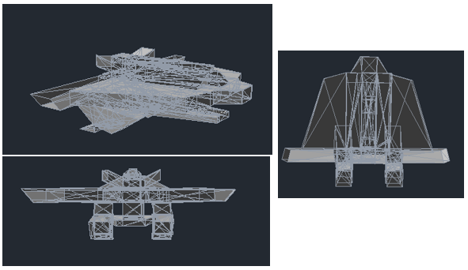
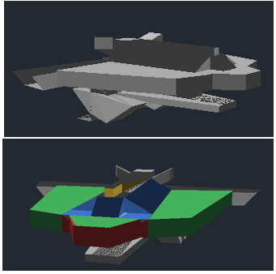
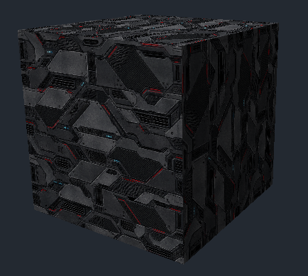

# Rust 3D Editor

Visor y editor 3D ligero por software, escrito en Rust. Se enfoca en visualizar modelos, ver la triangulación, seleccionar/pintar caras y exportar escenas completas.

--
## EJEMPLOS


vista triangular



vista solida y pintada 



vista de objeto demo texturizado.

--
## Requisitos

- Rust estable instalado con [rustup](https://rustup.rs/).
- Windows: no se requieren pasos adicionales normalmente.
- Linux: instalar las dependencias de ventana/gráficos que necesite `minifb` (X11/Wayland, según distribución).

puede  que se necesiten más librerías

```bash
sudo apt update
sudo apt install -y \
    libwayland-dev \
    libxkbcommon-dev \
    wayland-protocols \
    pkg-config \
    build-essential \
    zenity
```

## Ejecutar

Desde la carpeta del proyecto:

```bash
cargo run --release
```

Al iniciar se carga automáticamente `examples/models/demo.obj`, su `demo.mtl` y `demo.png`. Es el ejemplo texturizado incluido. También puedes abrir directamente un archivo desde la terminal:

```bash
cargo run --release -- "C:/modelos/mi_modelo.obj"
```

## Interfaz y controles

Hay una barra superior clicable para las acciones principales:

- **OPEN**: abrir OBJ, GLTF, GLB o proyecto R3D.
- **DEMO**: volver a cargar el cubo de prueba texturizado.
- **EXPORT**: crear una exportación completa en la carpeta `exports/`.
- **WIRE**: mostrar/ocultar aristas triangulares.
- **TEXT**: activar/desactivar texturas.
- **PAINT**: activar/desactivar pintura por cara.

Atajos:

| Tecla | Acción |
|---|---|
| `O` o `F2` | Abrir modelo/proyecto |
| `D` | Cargar el modelo DEMO texturizado |
| `F3` o `Ctrl+S` | Exportar todo el proyecto |
| `F12` | Guardar otra captura dentro de la última exportación |
| `C` | Cambiar cámara |
| `V` | Duplicar cámara activa |
| Clic derecho + arrastrar | Orbitar cámara |
| Clic central + arrastrar | Desplazar cámara |
| Rueda | Zoom |
| `F` | Encuadrar escena |
| `Home` | Restablecer cámara |
| Clic izquierdo | Seleccionar triángulo |
| `P` | Alternar modo pintura |
| `1`, `2`, `3`, `4` | Elegir rojo, verde, azul o amarillo |
| `5` | Volver al material/textura original como color de pintura |
| `Delete` | Quitar pintura de la cara seleccionada |
| `W` | Alternar triangulación |
| `T` | Alternar texturas |
| Flechas + `PageUp`/`PageDown` | Mover objeto seleccionado en XYZ |
| `M` + flechas/PageUp/PageDown | Mover objetivo de cámara |
| `G` + flechas/PageUp/PageDown | Mover toda la escena |
| `L` + flechas/PageUp/PageDown | Ajustar dirección de luz |
| `Alt` + flechas/PageUp/PageDown | Movimiento fino |
| `Esc` | Salir |

## Exportación organizada

`EXPORT`, `F3` o `Ctrl+S` crea automáticamente una carpeta única dentro de `exports/`, sin abrir un diálogo de guardar. La estructura será:

```text
exports/
└── export_<timestamp>_<scene>/
    ├── native/
    │   └── scene.r3d
    ├── obj/
    │   ├── scene.obj
    │   ├── scene.mtl
    │   └── textures/
    ├── gltf/
    │   ├── scene.gltf
    │   ├── scene.bin
    │   └── textures/
    ├── glb/
    │   └── scene.glb
    ├── captures/
    │   └── viewport.png
    └── manifest.json
```

Los formatos exportados son:

- **R3D:** proyecto editable de la aplicación, con geometría, cámaras, transformaciones, colores pintados y texturas guardadas dentro del archivo.
- **OBJ/MTL:** modelo geométrico, materiales y texturas PNG externas. La pintura por cara se convierte en materiales por cara.
- **glTF 2.0:** modelo, materiales PBR sencillos, texturas PNG externas y geometría en `scene.bin`.
- **GLB 2.0:** equivalente empaquetado; geometría y texturas PNG quedan dentro del único `.glb`.
- **PNG:** captura de la vista 3D sin la barra de botones.

`F12` guarda capturas adicionales en `captures/` de la última exportación. Si aún no existe una exportación, crea primero el paquete completo.

## Importación de texturas

- **OBJ/MTL:** el OBJ debe referenciar el MTL con `mtllib`. El MTL debe referenciar la textura con `map_Kd`. Se prueban rutas relativas al OBJ/MTL y al directorio de trabajo.
- **glTF:** se cargan imágenes externas y embebidas compatibles con glTF 2.0 para el canal base-color.
- El título de la ventana informa cuántas texturas se cargaron frente a cuántas estaban referenciadas.

## Alcance y limitaciones

Este es un renderizador por software con `minifb`, no un motor acelerado por GPU. Los modelos densos pueden ir lentos.

- glTF/GLB importa mallas/primitivas y cámaras; no reconstruye aún todas las transformaciones jerárquicas, skins ni animaciones.
- La exportación glTF/GLB hornea las transformaciones de los objetos en los vértices. Las cámaras y luces no se exportan todavía a esos formatos.
- La luz del visor es direccional y global.
- La pintura es por triángulo y se conserva como color por cara en R3D; para OBJ y glTF/GLB se convierte a materiales por cara.
- La pintura no modifica la imagen de textura UV original.
- No hay recorte geométrico completo de triángulos contra el plano cercano de la cámara.

## Solución de problemas

- Si al pulsar `O` no aparece el selector, prueba el botón **OPEN** de la barra o `F2`. En Windows, comprueba que el diálogo no haya quedado detrás de la ventana principal.
- Para verificar el cargador de texturas, pulsa **DEMO** y revisa que el título diga `texturas cargadas: 1/1`.
- Si indica `0/1`, confirma que `demo.mtl` y `demo.png` están en `examples/models/` junto a `demo.obj`.
- La exportación se crea en la carpeta `exports/` relativa al directorio desde el que ejecutaste `cargo run`.
